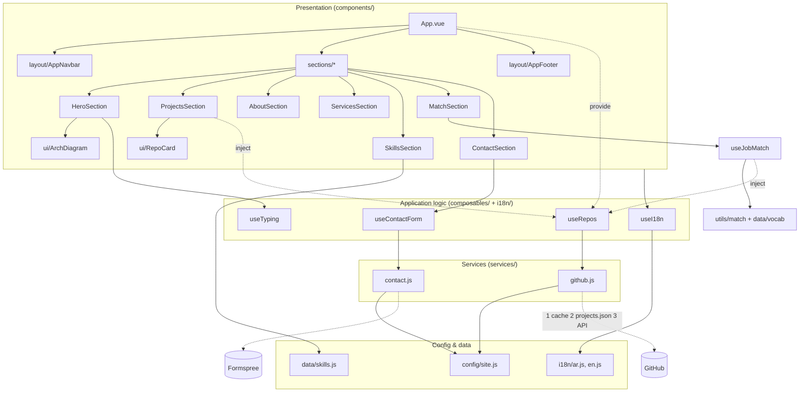

# Architecture — Portfolio (Vue 3 + Bootstrap 5 + Vite)

## 1. Principles
- **Data separated from UI:** all personal info, texts and skills live in `config/`, `i18n/`, `data/`. Components only render.
- **Logic in composables, I/O in services:** components never call `fetch` directly.
- **One direction of dependency:** `components → composables → services → config/utils`. Never the reverse.
- **No runtime CDN, no `unsafe-eval`:** templates are compiled at build time; fonts, Bootstrap and icons are bundled. CSP is `script-src 'self'`.

## 2. Layers


## 3. Folder structure
```
src/
  main.js                  entry: global CSS/fonts/Bootstrap JS, mounts App
  App.vue                  page composition only
  components/
    layout/   AppNavbar, AppFooter
    sections/ Hero, About, Services, Skills, Projects, Match, Contact   (one per page section)
    ui/       ArchDiagram, RepoCard                              (reusable pieces)
  composables/ useRepos (provided by App), useJobMatch, useTyping, useContactForm               (state + behaviour)
  services/    github.js, contact.js                             (network, caching, sanitising)
  i18n/        index.js (useI18n, RTL/LTR switch), ar.js, en.js
  directives/  reveal.js (v-reveal: scroll-in fade/rise, once)
  data/        skills.js                                         (skills + layer keys)
  config/      site.js                                           (identity, flags, endpoints)
  utils/       url.js (safeUrl), langColors.js, motion.js (reduced-motion + observer guards)
  styles/      base.css (tokens + shared); component CSS lives beside its component
tests/         app.spec.js (Vitest + Vue Test Utils)
public/        projects.json (generated in CI), assets/images/profile.jpg
.github/workflows/deploy.yml   test → build → GitHub Pages (daily refresh)
```

## 4. Data flow — projects
1. `ProjectsSection` calls `useRepos()` (state: repos, filters, featured, rest).
2. `useRepos` → `services/github.fetchRepos()`: session cache (10 min) → `projects.json` (built by CI, no rate limit) → GitHub API (fallback).
3. The service drops forks and hidden repos, runs every URL through `safeUrl` (https only) and sorts by stars then recency.
4. `RepoCard` renders; Vue escapes all text (no `v-html` anywhere).

## 5. Where to change what
| I want to… | Edit |
|---|---|
| Change name, email, links, feature repos, form endpoint | `config/site.js` |
| Edit any text (AR/EN) | `i18n/ar.js`, `i18n/en.js` |
| Add / re-level a skill | `data/skills.js` |
| Change colours | CSS variables at top of `styles/base.css` |
| Add a new page section | new file in `components/sections/` + one line in `App.vue` |
| Add a language | new `i18n/xx.js` + register in `i18n/index.js` |

## 6. Security & quality notes
- CSP in `index.html`: `script-src 'self'`, connections only to GitHub API and Formspree.
- Contact form: validation, honeypot field, endpoint configurable; falls back to `mailto:`.
- CI runs tests before build; the GitHub token is the ephemeral `GITHUB_TOKEN`, never shipped to the browser.
- Next steps: Playwright e2e, Lighthouse CI, per-project case-study pages (vue-router), prerendering for SEO.

## 7. Motion system
- **Tokens:** one easing `--ease: cubic-bezier(.22,1,.36,1)`; UI feedback ≤ 300 ms, scroll reveals ≈ 550 ms. Only `opacity` and `transform` animate.
- **Page load:** hero text rises in a staggered sequence (`.rise`, 100 ms steps), the architecture diagram lights up node by node, the facts count up once.
- **Scroll:** `v-reveal` fades sections/cards in once (IntersectionObserver, classes removed afterwards so hover stays instant); thin progress bar under the navbar; navbar gains a shadow after scrolling; scroll-spy underlines the current section.
- **Interaction:** buttons lift on hover and press at `scale(.97)`; project cards lift; filtering/searching repos re-enters cards with `TransitionGroup`.
- **Accessibility:** with `prefers-reduced-motion: reduce` all animation/transition is disabled and content is shown immediately; reveals are also skipped when IntersectionObserver is missing.

## 8. Job-fit matcher (differentiating feature)
A recruiter pastes a job description; `utils/match.js` finds known technologies (vocabulary in `data/vocab.js`, word-boundary matching so `Java` ≠ `JavaScript`, `SQL` ≠ `NoSQL`) and compares them with the technologies listed on the site (`mine: true`). It shows a match %, covered technologies, honest gaps, up to 3 related repos, and a pre-filled email. Everything runs in the browser; nothing is sent anywhere. To change what you claim, edit `mine` in `data/vocab.js`.
